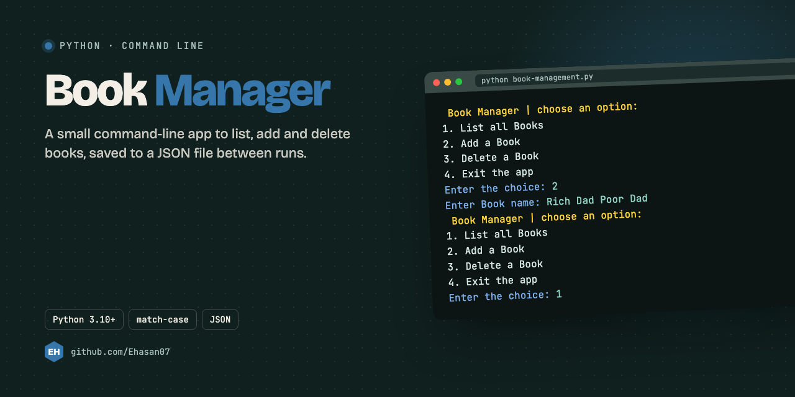

<p align="center"></p>

## About

A small command-line program to keep a list of books. The list is saved to `Book.txt` as JSON, so it is still there next time.

## What it does

- **1** list every book
- **2** add a book
- **3** delete a book by its number
- **4** exit

A real session:

```text
 Book Manager | choose an option:
1. List all Books
2. Add a Book
3. Delete a Book
4. Exit the app
Enter the choice: 2
Enter Book name: The Alchemist
```

## Run it

Needs Python 3.10 or newer (it uses `match`):

```bash
python3 book-management.py
```

## Built with

Python · `json` from the standard library

---

<p align="center"><sub>Made by <a href="https://github.com/Ehasan07">S M Ehasanul Haque</a> · Dhaka, Bangladesh · <a href="https://ehasanlive.com">ehasanlive.com</a></sub></p>
